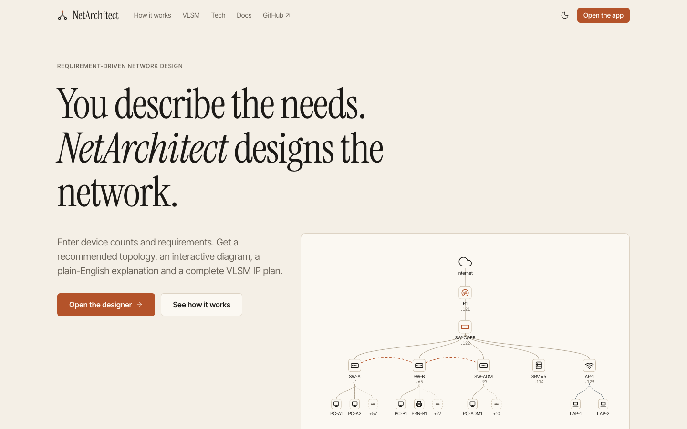
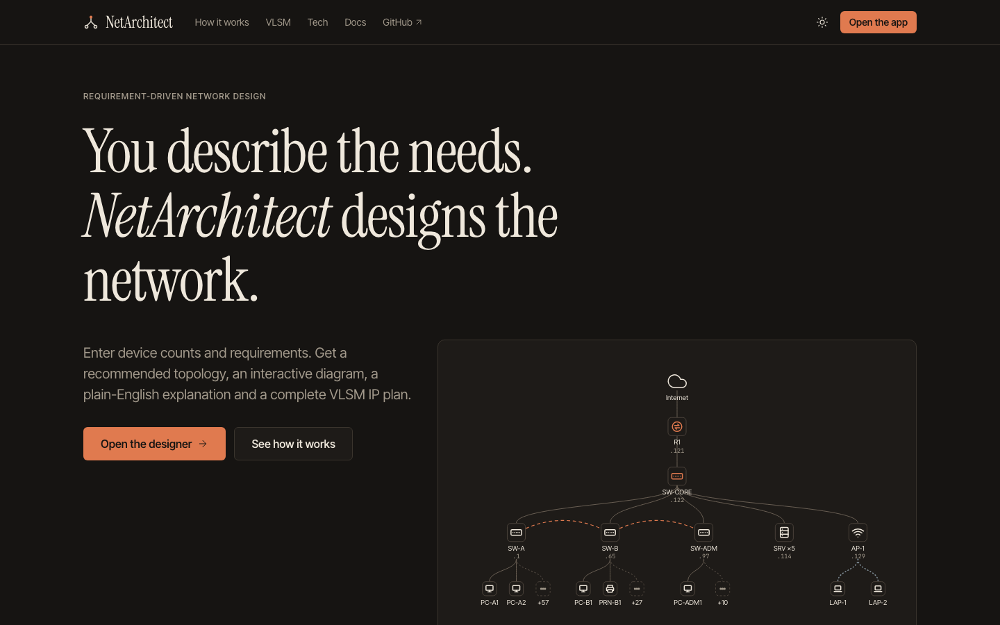
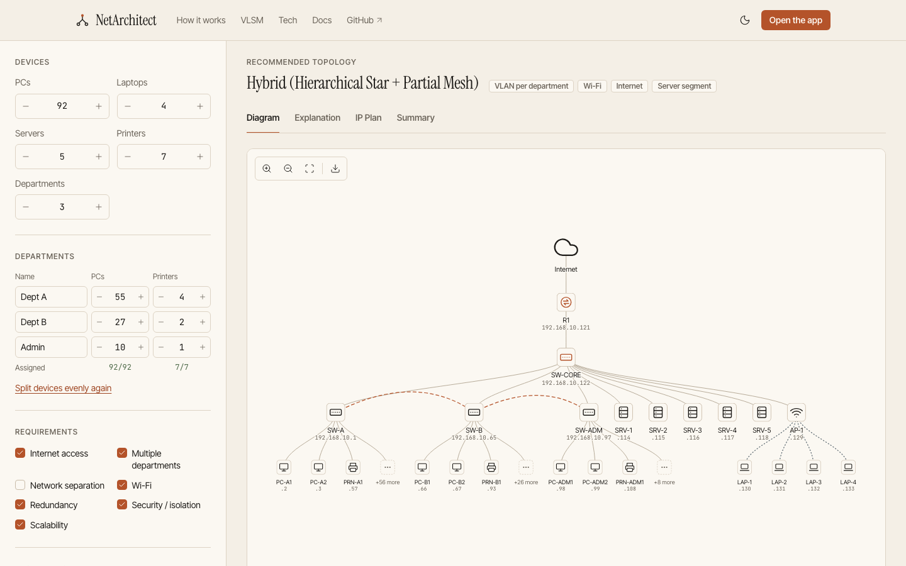
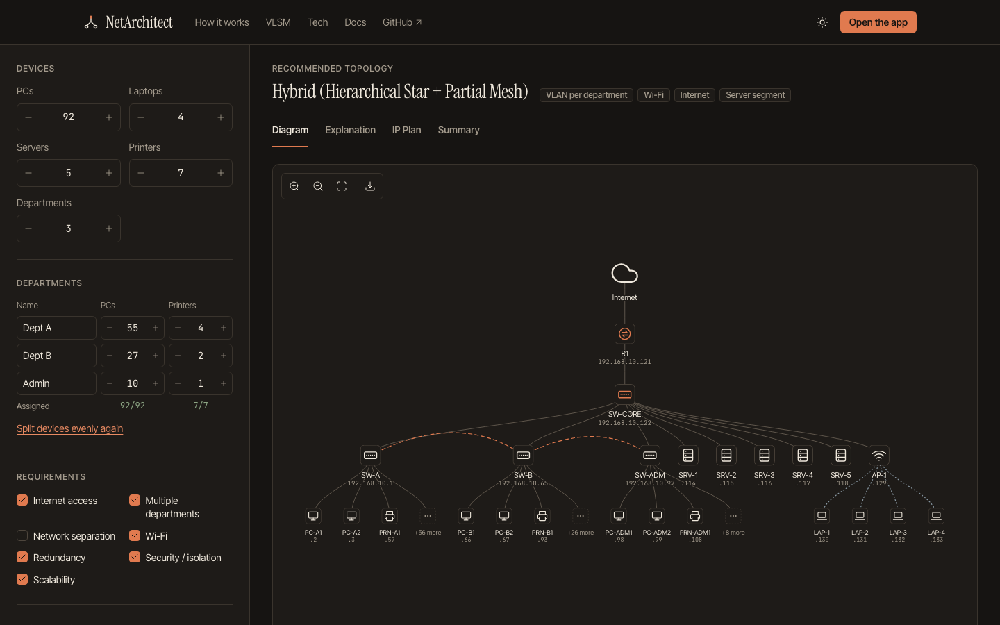
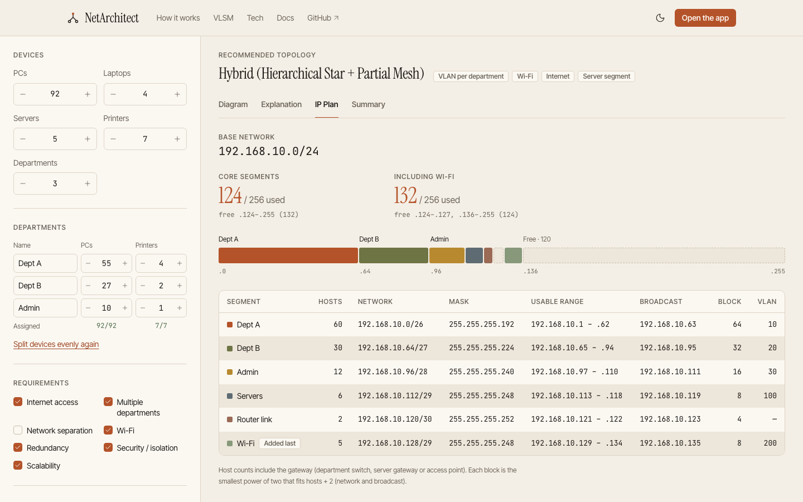
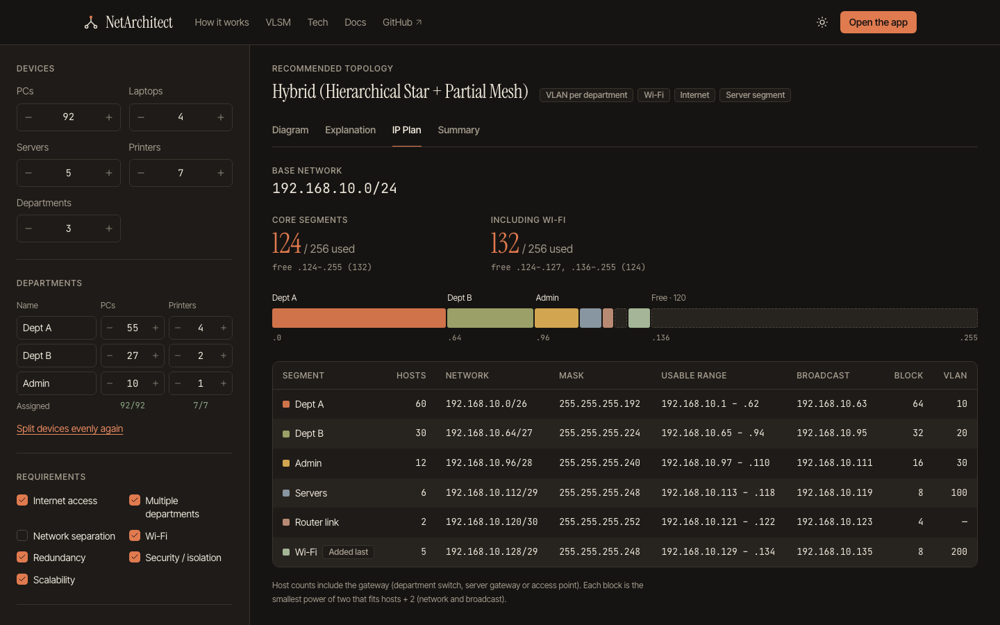

# NetArchitect

**You describe the needs. NetArchitect designs the network.**

NetArchitect is a requirement-driven network topology designer. You enter device counts and requirements, not a topology. It recommends a topology, draws an interactive diagram, explains every decision in plain English and produces a complete VLSM IP plan. Everything runs in the browser, with no backend.

_Computer Networks project, SRM Institute of Science and Technology, Kattankulathur._

## Screenshots

| Light                                                      | Dark                                                     |
| ---------------------------------------------------------- | -------------------------------------------------------- |
|  |  |
|     |     |
|       |       |

## Features

- **Requirements in, design out.** Device counts, departments and seven needs: internet, multiple departments, separation, Wi-Fi, redundancy, security, scalability.
- **Rule engine.** Data-driven if-then rules choose Star, Hierarchical Star, Ring, Partial Mesh or a Hybrid, and add VLANs, Wi-Fi, a router and a server segment.
- **Interactive diagram.** A layered diagram (internet → router → core → departments → devices). Click any device to see its type, IP, subnet, department, VLAN and links. You can zoom, fit and export a PNG in either theme.
- **Explanation.** A numbered "Why this design?" list, written for beginners.
- **VLSM IP plan.** Masks, usable ranges, broadcast addresses, and an address-space bar showing how the base network is packed.
- **Summary.** Totals counted from the generated graph.
- **Light and dark themes.** Follows the system setting, remembers your choice, and doesn't flash on load.

## How it works

```
Requirements → Analyze → Recommend topology → Draw network → Explain design → Assign IPs (VLSM) → Summary
```

The engine in `src/engine/` is plain JavaScript with no React or browser dependency, and it is unit tested on its own.

| File               | Role                                                                             |
| ------------------ | -------------------------------------------------------------------------------- |
| `validation.js`    | Friendly form validation                                                         |
| `ruleEngine.js`    | `RULES` array of `{ id, kind, condition, action, reason }` → topology + features |
| `segments.js`      | Requirements → list of subnets (host counts include each gateway)                |
| `vlsm.js`          | Sort largest first → smallest power-of-2 block ≥ hosts + 2 → aligned allocation  |
| `graphBuilder.js`  | Layered nodes/edges, device naming, IP assignment, "+N more" grouping            |
| `explainer.js`     | Plain-English reasons for every rule and subnet                                  |
| `summary.js`       | Stat cards computed from the graph                                               |
| `designNetwork.js` | Runs the whole pipeline                                                          |

**Demo scenario.** The demo is 192.168.10.0/24 with internet, multiple departments, redundancy, security, Wi-Fi and scalability. It produces:

- Dept A 192.168.10.0/26
- Dept B .64/27
- Admin .96/28
- Servers .112/29
- Router link .120/30

That is 124 of 256 addresses used, leaving .124–.255 free (132). Wi-Fi is then placed at .128/29. The topology is a **Hybrid (Hierarchical Star + Partial Mesh)** with one VLAN per department. The landing page computes this example live from `vlsm.js`, and a test makes sure the landing page and the engine always agree.

More detail is on the in-app **Docs** page (`/docs`).

## Tech stack

| Tool                | Role                                                       |
| ------------------- | ---------------------------------------------------------- |
| React 19 + Vite     | UI and build; the `/app` and `/docs` routes are code-split |
| React Router        | `/`, `/app`, `/docs`, 404                                  |
| vis-network         | Diagram rendering (lazy-loaded only on `/app`)             |
| Vitest              | Engine unit tests                                          |
| Plain CSS variables | Design tokens in `src/styles/tokens.css`, no CSS framework |
| lucide-react        | Icons                                                      |
| @fontsource         | Self-hosted Instrument Serif, Inter Tight, JetBrains Mono  |

## Local setup

You need Node.js 18 or newer.

```bash
npm install
npm run dev
```

Open http://localhost:5173. Some useful URLs:

- `/app?demo=1` loads the demo immediately.
- `?theme=dark` or `?theme=light` forces a theme for that page load.

| Script                | What it does                                                        |
| --------------------- | ------------------------------------------------------------------- |
| `npm run dev`         | Dev server                                                          |
| `npm run build`       | Production build in `dist/`                                         |
| `npm run preview`     | Serve the production build (port 4173)                              |
| `npm test`            | Vitest unit tests                                                   |
| `npm run lint`        | ESLint (zero warnings allowed)                                      |
| `npm run format`      | Prettier                                                            |
| `npm run assets`      | Regenerate `og-image.png` and `apple-touch-icon.png` (needs Chrome) |
| `npm run screenshots` | Regenerate README screenshots from a running preview                |

## Tests

```bash
npm test
```

There are 28 tests. They cover:

- **VLSM:** the demo values, overflow with a suggested bigger base, and skipping 0-host segments.
- **Rule engine:** Star, Hierarchical, Hybrid with partial mesh, Ring, VLAN feature, and custom rules.
- **Graph and summary:** counts equal the generated graph, and every device has an IP.
- **Other:** validation, and the landing page's worked example.

## Deployment

The site is static and builds to `dist/`. Both hosts are preconfigured: `vercel.json` and `netlify.toml` / `public/_redirects` handle client-side routing.

**Vercel (CLI):**

```bash
npx vercel --prod
```

**Vercel (Git):** the code lives at https://github.com/mokshad25/NetArchitect. Choose _Add New → Project_ in Vercel, then import the repo. Vercel detects the Vite framework, the build command `npm run build` and the output directory `dist`.

**Netlify:** `npx netlify deploy --prod`, or import the repo. `netlify.toml` already sets the build.

After the first deploy, set the real URL in:

- `src/config/site.js` (`SITE_URL`)
- `index.html` (canonical and Open Graph URLs)
- `public/robots.txt`
- `public/sitemap.xml`

Set `TEAM_NAMES` in `src/config/site.js` too.

## Project structure

```
src/
  engine/              pure logic (rules, VLSM, graph, explanations, summary, validation)
  features/designer/   designer page: form, diagram (vis-network), IP plan, summary, explanation
  features/landing/    landing-page data computed from the engine
  components/ui/       primitives: Button, Tabs, Table, TextField, NumberStepper, Checkbox, Badge, Toast, …
  components/layout/   Navbar, Footer, Layout
  components/landing/  landing-page sections
  pages/               Landing, DesignerPage, DocsPage, NotFound
  lib/                 theme provider, CSS-variable reader, page meta, scroll helpers
  styles/              tokens.css, base.css, shared.css
tests/                 Vitest suites
scripts/               asset + screenshot generators
public/                favicon, OG image, robots.txt, sitemap.xml, _redirects
```

## Roadmap

- IPv6 addressing
- Export to Cisco Packet Tracer
- VLAN and routing configuration generation
- Hardware cost estimation

## Team

Team names live in `TEAM_NAMES` in `src/config/site.js`. They appear in the site footer.

- Team member 1
- Team member 2
- Team member 3
- Team member 4
